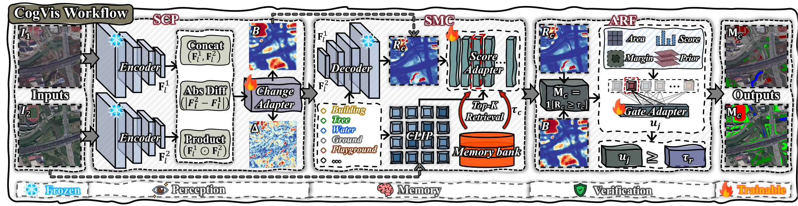
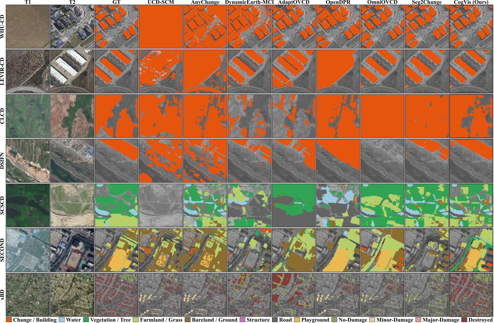
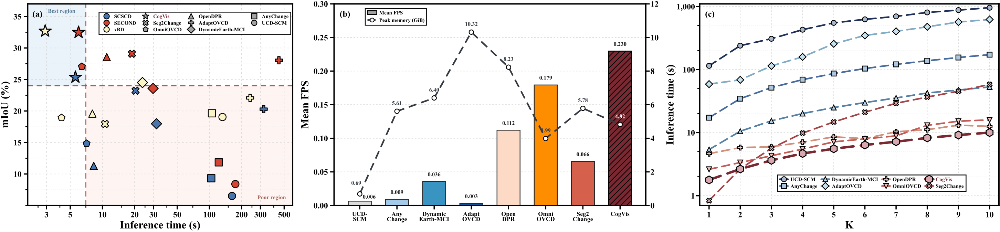

<p align="center">
  
</p>

<h1 align="center">CogVis</h1>

<p align="center">
  <strong>Must Open-Vocabulary Change Detection Perceive the Scene Anew for Every Query?</strong>
</p>

<p align="center">
  Perceive the scene once. Recall the right boundary. Verify every region.
</p>

<p align="center">
  
  
  
  
  <a href="https://arxiv.org/abs/2608.06150"></a>
</p>

> **TL;DR:** CogVis extracts category-agnostic change evidence once, calibrates each text query with semantic memory, and verifies the resulting regions. It achieves the best reported result on all seven evaluated benchmarks while improving inference throughput by **28.50%**.

> ⭐ If CogVis supports your research, consider starring this repository to follow future releases.

## ✨ Key Highlights

- ⚡ **Query-shared perception:** temporal evidence is computed once per image pair and reused across categories.
- 🏆 **Seven-benchmark performance:** CogVis leads all evaluated semantic CD, binary CD, and damage-assessment benchmarks.
- 🧠 **Memory-guided decisions:** query-specific thresholds adapt to scene and category score shifts.
- 🧩 **Lightweight adaptation:** SAM3 and CLIP remain frozen; only three compact adapters are optimized.

## 🔥 News

- **`2026-11-04`**: 🚀 Updated the released code with the paper-locked `eta_a = 0.04` protection and added weight download links.
- **`2026-08-06`**: 📄 The CogVis paper is now available on [arXiv](https://arxiv.org/abs/2608.06150), together with refreshed documentation and visual identity.
- **`2026-08-04`**: Released seven-benchmark inference, staged adapter training, and paper-locked prompt profiles.

## 👀 Overview

CogVis reformulates Open-Vocabulary Change Detection as a scene-first **perception-memory-verification** process. Its temporal prior is shared across queries, while semantic calibration and region verification remain query-specific.



## 📊 Results

Updated results with the released configuration (mean over five seeds, 2026-10-28); the manuscript's single-checkpoint table is reported in the [CogVis paper](https://arxiv.org/abs/2608.06150):

<table align="center">
  <thead>
    <tr>
      <th align="left">Task</th>
      <th align="left">Dataset</th>
      <th align="center">Metric</th>
      <th align="center">Prior best</th>
      <th align="center">CogVis</th>
      <th align="center">Gain</th>
    </tr>
  </thead>
  <tbody>
    <tr>
      <td align="left">Semantic CD</td>
      <td align="left">SECOND</td>
      <td align="center">mIoU</td>
      <td align="center">31.67</td>
      <td align="center"><strong>32.36</strong></td>
      <td align="center"><strong>+0.69</strong></td>
    </tr>
    <tr>
      <td align="left">Semantic CD</td>
      <td align="left">SCSCD</td>
      <td align="center">mIoU</td>
      <td align="center">23.22</td>
      <td align="center"><strong>26.38</strong></td>
      <td align="center"><strong>+3.16</strong></td>
    </tr>
    <tr>
      <td align="left">Binary CD</td>
      <td align="left">CLCD</td>
      <td align="center">IoU</td>
      <td align="center">31.48</td>
      <td align="center"><strong>34.70</strong></td>
      <td align="center"><strong>+3.22</strong></td>
    </tr>
    <tr>
      <td align="left">Binary CD</td>
      <td align="left">DSIFN</td>
      <td align="center">IoU</td>
      <td align="center">47.55</td>
      <td align="center"><strong>50.36</strong></td>
      <td align="center"><strong>+2.81</strong></td>
    </tr>
    <tr>
      <td align="left">Binary CD</td>
      <td align="left">LEVIR-CD</td>
      <td align="center">IoU</td>
      <td align="center">72.50</td>
      <td align="center"><strong>73.87</strong></td>
      <td align="center"><strong>+1.37</strong></td>
    </tr>
    <tr>
      <td align="left">Binary CD</td>
      <td align="left">WHU-CD</td>
      <td align="center">IoU</td>
      <td align="center">75.72</td>
      <td align="center"><strong>78.23</strong></td>
      <td align="center"><strong>+2.51</strong></td>
    </tr>
    <tr>
      <td align="left">Damage assessment</td>
      <td align="left">xBD</td>
      <td align="center">mIoU</td>
      <td align="center">24.51</td>
      <td align="center"><strong>32.62</strong></td>
      <td align="center"><strong>+8.11</strong></td>
    </tr>
  </tbody>
</table>

<p align="center"><sub>Means over seeds 2026–2030; sample SDs (ddof=1) are 0.14, 0.35, 1.12, 0.38, 0.24, 0.52, and 0.05 for SECOND, SCSCD, CLCD, DSIFN, LEVIR-CD, WHU-CD, and xBD. This is the new locked-protocol five-seed series; the manuscript's original single-checkpoint table is retained in the paper.</sub></p>



<details>
<summary><strong>⚡ Efficiency and query scaling</strong></summary>

On an RTX 3090 with 512 x 512 inputs, CogVis reaches **0.230 FPS** with **4.82 GiB** peak memory. At 10 queried categories, it requires **10.03 s**, compared with **12.56-956.60 s** for category-wise baselines.



</details>

## 🛠️ Preparation

### Environment

CogVis is tested on Ubuntu with an NVIDIA GPU, CUDA 12.1, and Python 3.10.

```bash
conda create -n cogvis python=3.10 -y
conda activate cogvis
python -m pip install -r requirements.txt
```

Run all commands below from the repository root.

### Checkpoints

Model weights are intentionally excluded from Git. Place the following files under `weights/`:

<table align="center">
  <thead>
    <tr>
      <th align="left">Checkpoint</th>
      <th align="left">Component</th>
      <th align="left">Download</th>
    </tr>
  </thead>
  <tbody>
    <tr>
      <td align="left"><code>change_adapter.pt</code></td>
      <td align="left">Scene Change Perceptron</td>
      <td align="left"><a href="https://drive.google.com/file/d/15X81-fZJYxe8InOPTpxLZTQ0PbZ5w9M7/view?usp=drive_link">Google Drive</a></td>
    </tr>
    <tr>
      <td align="left"><code>score_adapter.pt</code></td>
      <td align="left">Semantic Memory Calibrator</td>
      <td align="left"><a href="https://drive.google.com/file/d/1Yf9s8KbfHAjKuMIcg-XTwdL9x8ALrrdw/view?usp=drive_link">Google Drive</a></td>
    </tr>
    <tr>
      <td align="left"><code>gate_adapter.pt</code></td>
      <td align="left">Adaptive Region Filter</td>
      <td align="left"><a href="https://drive.google.com/file/d/1P12uZ8t9zei961HzH5Kdnop1zkWyX9cj/view?usp=drive_link">Google Drive</a></td>
    </tr>
    <tr>
      <td align="left"><code>sam3.pt</code></td>
      <td align="left">Frozen SAM3 backbone</td>
      <td align="left"><a href="https://huggingface.co/facebook/sam3">Official SAM 3</a></td>
    </tr>
    <tr>
      <td align="left"><code>ViT-B-16.pt</code></td>
      <td align="left">Frozen CLIP encoder</td>
      <td align="left"><a href="https://openaipublic.azureedge.net/clip/models/5806e77cd80f8b59890b7e101eabd078d9fb84e6937f9e85e4ecb61988df416f/ViT-B-16.pt">Official CLIP</a></td>
    </tr>
  </tbody>
</table>

<p align="center"><sub>SAM 3 is a gated Hugging Face repository: request access and authenticate before downloading <code>sam3.pt</code>. The CLIP link is OpenAI's official ViT-B/16 checkpoint.</sub></p>

Use a custom checkpoint directory when needed:

```bash
export COGVIS_WEIGHT_DIR=/path/to/weights
```

### Datasets

CA-CDD is used for adapter optimization and memory construction. Six CD datasets and xBD are used for evaluation.

<details>
<summary><strong>Expected directory structure</strong></summary>

```text
CogVis/
|-- data/
|   |-- OVCD_Benchmark/
|   |   |-- CACDD/
|   |   |-- SECOND/
|   |   |-- SCSCD/
|   |   |-- CLCD-512/
|   |   |-- DSIFN-512/
|   |   |-- LEVIR-CD-512/
|   |   `-- WHU-CD-512/
|   `-- xBD/
|       `-- test/
|           |-- images/
|           |-- labels/
|           `-- targets/
`-- weights/
    |-- change_adapter.pt
    |-- score_adapter.pt
    |-- gate_adapter.pt
    |-- sam3.pt
    `-- ViT-B-16.pt
```

For datasets stored outside the repository:

```bash
export COGVIS_OVCD_BENCHMARK_ROOT=/path/to/OVCD_Benchmark
export COGVIS_XBD_ROOT=/path/to/xBD/test
```

</details>

## 🎯 Usage

Validate the command contracts without loading models or writing predictions:

```bash
python infer.py --dataset all --dry-run
python train.py all-adapters --dry-run
```

### Inference

Evaluate all seven benchmarks:

```bash
python infer.py \
  --dataset all \
  --device 0 \
  --output-dir outputs/inference
```

Evaluate one semantic or binary dataset:

```bash
python infer.py \
  --dataset SECOND \
  --device 0 \
  --save-predictions \
  --output-dir outputs/second
```

Supported names are `SECOND`, `SCSCD`, `CLCD-512`, `DSIFN-512`, `LEVIR-CD-512`, and `WHU-CD-512`.

Evaluate xBD:

```bash
python infer.py \
  --dataset xBD \
  --num-chunks 7 \
  --device 0 \
  --output-dir outputs/xbd
```

### Training

The three adapters are optimized sequentially. The default paper recipe uses 4,968 samples, 8 shards, 100 epochs per adapter, and seed 2026.

```bash
python train.py all-adapters \
  --benchmark-root "$COGVIS_OVCD_BENCHMARK_ROOT" \
  --cache-root /path/to/cache-parent \
  --clip-cache-dir "${COGVIS_WEIGHT_DIR:-$PWD/weights}" \
  --device 0 \
  --output-dir outputs/training/all
```

Individual stages are available as `change-adapter`, `score-adapter`, and `gate-adapter`. Run `python infer.py --help` or `python train.py --help` for the complete option set.

<details>
<summary><strong>⚙️ Configuration overrides</strong></summary>

| Variable | Purpose | Default |
|:---|:---|:---|
| `COGVIS_OVCD_BENCHMARK_ROOT` | CA-CDD and six evaluation datasets | `data/OVCD_Benchmark` |
| `COGVIS_XBD_ROOT` | xBD test split | `data/xBD/test` |
| `COGVIS_WEIGHT_DIR` | Adapter and foundation-model weights | `weights` |
| `COGVIS_RESULTS_DIR` | Inference and training outputs | `outputs` |
| `COGVIS_PROMPTS` | Paper-locked prompt profiles | `prompts.json` |
| `COGVIS_CHANGE_ADAPTER_CHECKPOINT` | Change Adapter override | `weights/change_adapter.pt` |
| `COGVIS_SCORE_ADAPTER_CHECKPOINT` | Score Adapter override | `weights/score_adapter.pt` |
| `COGVIS_GATE_ADAPTER_CHECKPOINT` | Gate Adapter override | `weights/gate_adapter.pt` |
| `COGVIS_SAM3_CHECKPOINT` | SAM3 checkpoint override | `weights/sam3.pt` |
| `COGVIS_CLIP_CACHE_DIR` | CLIP checkpoint directory | `weights` |

</details>

## 🤝 Acknowledgement

CogVis builds on frozen SAM3 visual features and CLIP ViT-B/16 text embeddings. We thank the authors and maintainers of the foundation models, benchmarks, and open-source libraries that make this reproduction possible.

## 📄 Citation

If you find CogVis useful in your research, please cite:

```bibtex
@article{wang2026cogvis,
  title   = {CogVis: Must Open-Vocabulary Change Detection Perceive the Scene Anew for Every Query?},
  author  = {Wang, Zijie and Zhong, Chen and He, Wei},
  journal = {arXiv preprint arXiv:2608.06150},
  year    = {2026},
  url     = {https://arxiv.org/abs/2608.06150}
}
```
